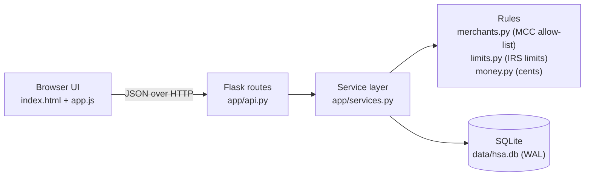
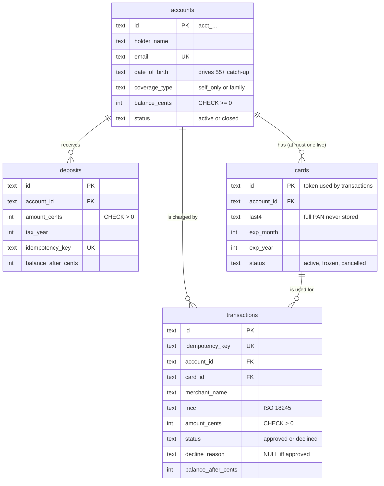

# Architecture

## 1. System architecture



Three layers, each with one job:

| Layer | Responsibility | Knows about HTTP? | Knows about SQL? |
| --- | --- | --- | --- |
| `api.py` | Parse JSON, call one service function, map results/errors to status codes | yes | no |
| `services.py` | All business rules and every transaction boundary | no | yes |
| `schema.sql` | Shape of the data plus invariants the database itself enforces | no | yes |

The service layer takes a plain `sqlite3.Connection`, not a Flask request. That is why the
concurrency tests can drive it directly from 40 threads, and why swapping Flask for another
framework would touch only `api.py`.

The server runs threaded (`app.run(threaded=True)`): each HTTP request gets its own OS
thread and its own SQLite connection, so concurrent purchases genuinely race, just as they
would behind a production WSGI server.

## 2. Request flow: authorizing a purchase

```mermaid
sequenceDiagram
    participant C as Client (card network / UI)
    participant A as api.py
    participant S as services.process_transaction
    participant D as SQLite
    C->>A: POST /api/transactions {card_id, amount, merchant_name, mcc, idempotency_key}
    A->>S: process_transaction(conn, body)
    S->>S: validate input, parse amount to integer cents
    S->>D: BEGIN IMMEDIATE (take the write lock; other writers wait)
    S->>D: SELECT by idempotency_key
    alt key seen before
        D-->>S: existing transaction
        S-->>A: same result, replayed=true (HTTP 200)
    else new request
        S->>D: SELECT card, SELECT account
        S->>S: card frozen/cancelled/expired? account closed? MCC qualified?
        opt all checks pass
            S->>D: UPDATE accounts SET balance = balance - amt<br/>WHERE id = ? AND balance >= amt RETURNING balance
            Note over S,D: 0 rows updated means INSUFFICIENT_FUNDS
        end
        S->>D: INSERT transactions (approved or declined, with reason and balance_after)
        S->>D: COMMIT (releases lock)
        S-->>A: transaction (HTTP 201)
    end
    A-->>C: JSON
```

Check order is deliberate: **card state, then account state, then merchant eligibility,
then funds.** A $500 restaurant charge on a $5 balance is declined as
`NOT_QUALIFIED_MEDICAL_EXPENSE`, not `INSUFFICIENT_FUNDS`, because that is the reason that
would still apply after a deposit.

**A declined purchase is not an HTTP error.** The request was valid and fully processed; the
business answer was "no". It returns `201` with `status: "declined"` and a machine-readable
`decline_reason`. HTTP errors (`404`, `409`, `422`) are reserved for requests that cannot be
processed at all, such as an unknown card or malformed amount.

Deposits follow the same pattern: `BEGIN IMMEDIATE`, idempotency check, sum this tax year's
deposits, reject if over the IRS limit, credit the balance, insert the deposit row, commit.

## 3. Data model



### Modelling decisions

**Account information.** Name and email identify the holder (email is unique). Date of
birth and HDHP coverage type are included because they determine the IRS annual
contribution limit: $4,400 self-only or $8,750 family in 2026, plus a $1,000 catch-up for
holders who are 55 or older during the tax year. I deliberately did not collect SSN,
address, or employer: they matter for KYC and payroll in a real product but add nothing to
the flows being evaluated, and sensitive fields should not exist in a demo database.

**Money is integer cents everywhere.** Inputs are parsed `str -> Decimal -> int`, and
inputs with sub-cent precision are rejected rather than rounded. Formatting back to dollars
is integer-only too (`divmod`), so no float ever touches a balance.

**`balance_cents` is a stored running balance, backed by a ledger.** Deposits and approved
transactions together form a complete ledger, so the balance could be computed as
`SUM(deposits) - SUM(approved transactions)`. Storing it as well gives the concurrency
control a single row to lock and conditionally update, and makes reads O(1). Every test
asserts the invariant `balance == deposits - approved spend` so the two cannot drift silently.

**Declined attempts are recorded.** Every authorization attempt is a row, with its reason
and the balance at decision time. This is the audit trail a support agent or regulator
would ask for ("why was my pharmacy charge declined at 2:14pm?").

**Database-enforced invariants**, not just application checks:
- `CHECK (balance_cents >= 0)` on accounts
- `CHECK (amount_cents > 0)` on deposits and transactions
- `CHECK ((status = 'approved') = (decline_reason IS NULL))` on transactions
- A **partial unique index** `ON cards(account_id) WHERE status IN ('active','frozen')`: at
  most one live card per account, even if two "issue card" requests race
- `UNIQUE (idempotency_key)` on deposits and transactions

**Cards.** The 16-digit, Luhn-valid number is generated at issuance and returned **once**;
only `last4` is persisted. Transactions reference the card by its opaque `card_id`, which
plays the role of a network token. In production the PAN would live in a PCI-scoped vault
and the authorization request would arrive from the card processor with a token. Cards
expire 3 years after issuance and are valid through the end of the expiry month. Replacing
a card cancels the old one in the same transaction.

**Qualified-expense rule: MCC allow-list.** Card networks tag every authorization with a
merchant category code. Pharmacies (5912), hospitals (8062), doctors, dentists, vision,
labs, ambulance and medical equipment are on the allow-list; everything else, including
unknown codes, is declined. Failing closed is the right default for a tax-advantaged
account: a wrongly approved purchase becomes taxable income plus a 20% penalty for the
holder, whereas a wrongly declined one is a recoverable inconvenience.

**Why SQLite.** It is a real ACID database with real locking, needs zero setup for a
reviewer, and its single-writer model makes the concurrency story easy to reason about
and to test. Section 5 covers what changes with Postgres.

## 4. Concurrency handling

The required scenario: balance $100, purchases of $80 and $50 arrive at the same time.
Only one may be approved, and the balance must never go negative.

The bug to prevent is the classic **check-then-act race**:

```
A: read balance = 100     B: read balance = 100
A: 100 >= 80, approve     B: 100 >= 50, approve
A: write 100 - 80 = 20    B: write 100 - 50 = 50    <- $130 spent from $100
```

Note the final balance there is **$50, which is positive**. A `CHECK (balance >= 0)`
constraint alone would not catch this lost update. `tests/test_concurrency.py` includes a
control test that runs exactly this naive code under the same harness and confirms it
approves both purchases.

### Three layers of protection

1. **`BEGIN IMMEDIATE` serializes every write transaction** (`db.write_transaction`). The
   write lock is taken *before* the first read, so the read of the balance, the decision,
   and the write all happen while no other writer can run. A second purchase waits (up to
   `busy_timeout`, 10s) and then sees the already-reduced balance.

   This is specifically `IMMEDIATE`, not SQLite's default `DEFERRED`. A deferred
   transaction starts as a reader and upgrades to a writer at its first write; two
   concurrent deferred transactions that have both read cannot both upgrade, and SQLite
   fails one *immediately* with `database is locked`, ignoring `busy_timeout`. Under the
   race tests, switching to plain `BEGIN` produces 56 such errors.

2. **The debit is one conditional statement:**
   `UPDATE accounts SET balance_cents = balance_cents - :amt WHERE id = :id AND balance_cents >= :amt RETURNING balance_cents`.
   Checking and taking funds is a single atomic operation; zero rows updated means
   insufficient funds. This is the same pattern that works on any SQL database without
   explicit row locks.

3. **`CHECK (balance_cents >= 0)`** turns any remaining overdraft bug into a failed write
   (HTTP 500 and a rollback) instead of a negative balance.

### Which layer is actually load-bearing? (measured, not assumed)

`scripts/mutation_check.py` removes each layer in a copy of the code and reruns the
concurrency tests:

| Variant | Purchases | Deposit limit under race | Idempotent retries under race | Tests |
| --- | --- | --- | --- | --- |
| As built (lock + conditional UPDATE + CHECK) | correct | correct | correct | pass |
| Lock only, debit as read-check-write in Python | correct | correct | correct | pass |
| Conditional UPDATE only, no lock | correct | **20 of 20 $300 deposits accepted ($6,000 vs $4,400 limit)** | **UNIQUE violation, HTTP 500** | fail |
| Deferred `BEGIN` | `database is locked` errors | errors | errors | fail |
| No lock, read-check-write (naive) | **overspends** | overspends | 500s | fail |

Conclusion: **the transaction lock is the essential guarantee.** The conditional UPDATE
fully protects the balance on its own, but rules that span multiple rows (the year-to-date
contribution sum; "has this idempotency key been used?") need the whole check-then-insert
sequence to be serialized. The conditional UPDATE and CHECK constraint remain as cheap
defense in depth.

### Idempotency

Card networks retry on timeouts. Each purchase carries an `idempotency_key` (the UI sends
a UUID). Inside the locked transaction, a repeated key returns the original result with
HTTP 200 instead of charging again; the same key with a different amount, card or MCC is
rejected with `409`. Fifteen simultaneous retries with the same key produce exactly one
charge (tested).

### How it is tested

- `test_spec_example_100_balance_80_and_50_concurrently`: the brief's exact scenario, 50
  rounds, two threads released by a `threading.Barrier`. Exactly one approval each round,
  and the balance matches whichever purchase won.
- 40 x $10 against $100: exactly 10 approved, balance exactly $0.
- `balance_after` values of approved purchases form an unbroken sequence
  (100 - 7, 100 - 14, ...), proving each purchase saw its predecessor's write.
- Mixed qualified and non-qualified merchants, purchases interleaved with deposits,
  concurrent deposits against the annual limit, concurrent idempotent retries.
- `test_http.py` repeats the race with 30 simultaneous HTTP requests against a real
  threaded server.
- The UI's Concurrency Lab fires requests with `Promise.all` so a reviewer can watch it live.

## 5. Design tradeoffs

| Decision | Benefit | Cost / what I'd change at scale |
| --- | --- | --- |
| SQLite, database-wide write lock | Zero setup; simple, provable correctness | All writes, even for unrelated accounts, are serialized. Fine for thousands of TPS of sub-millisecond transactions; not for a real card program. On **Postgres** I would keep the conditional `UPDATE` and replace `BEGIN IMMEDIATE` with `SELECT ... FROM accounts WHERE id = $1 FOR UPDATE` so locking is per account, and back idempotency with the unique constraint plus `ON CONFLICT`. |
| Stored balance + ledger rows | O(1) balance reads, one row to lock | Two sources that must agree; guarded by tests, would add a nightly reconciliation job in production |
| MCC allow-list | Simple, explainable, fails closed | Too coarse in both directions: a pharmacy also sells candy; a grocery store's pharmacy counter is declined. Real programs add **IIAS** item-level substantiation (SKU lists from the merchant) and let holders submit receipts for manual review |
| Purchase is a single-step authorization | Easy to reason about and demo | Real card flows are **authorize then capture/settle**, with holds, partial captures, reversals and refunds. I would model holds as a separate `available` vs `ledger` balance |
| Declines return HTTP 201 | Clean separation of "processed" vs "invalid request" | Clients must check `status`, not just the HTTP code (documented) |
| Full PAN shown once, never stored | No sensitive card data at rest | A lost number cannot be retrieved; the user replaces the card (as real issuers do) |
| No authentication | Lets a reviewer exercise every flow immediately | Mandatory before anything real: per-user auth, accounts scoped to the caller, admin-only card controls |
| Contribution limits hard-coded in `limits.py` | Visible and tested | Should be a compliance-maintained config table keyed by tax year; prior-year contributions until the tax deadline are not modelled |
| Vanilla JS UI, no build step | `python run.py` is the whole setup | Less structure than React for a larger UI |

## 6. What I would improve with more time

1. Authorize/capture with holds, reversals and refunds (refunds credit the balance back).
2. Postgres with per-account row locks, plus a load test showing throughput across many accounts.
3. Authentication and authorization; audit log of who did what.
4. IIAS-style item-level eligibility and a receipt-substantiation flow for edge cases.
5. Withdrawals/reimbursements to a bank account, and the 20% penalty logic for
   non-qualified distributions before age 65.
6. Contribution limits as data; employer vs. employee contributions; prior-year contributions.
7. Structured logging and metrics (decline rate by reason, lock wait time).
