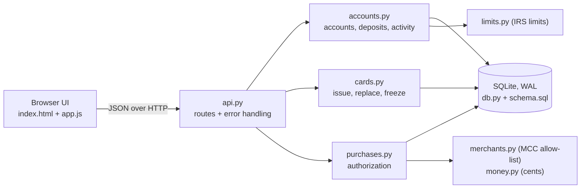
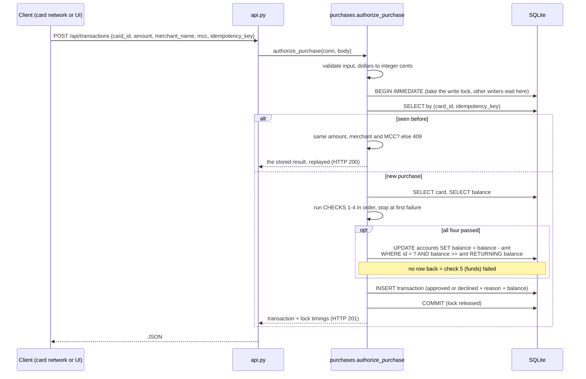
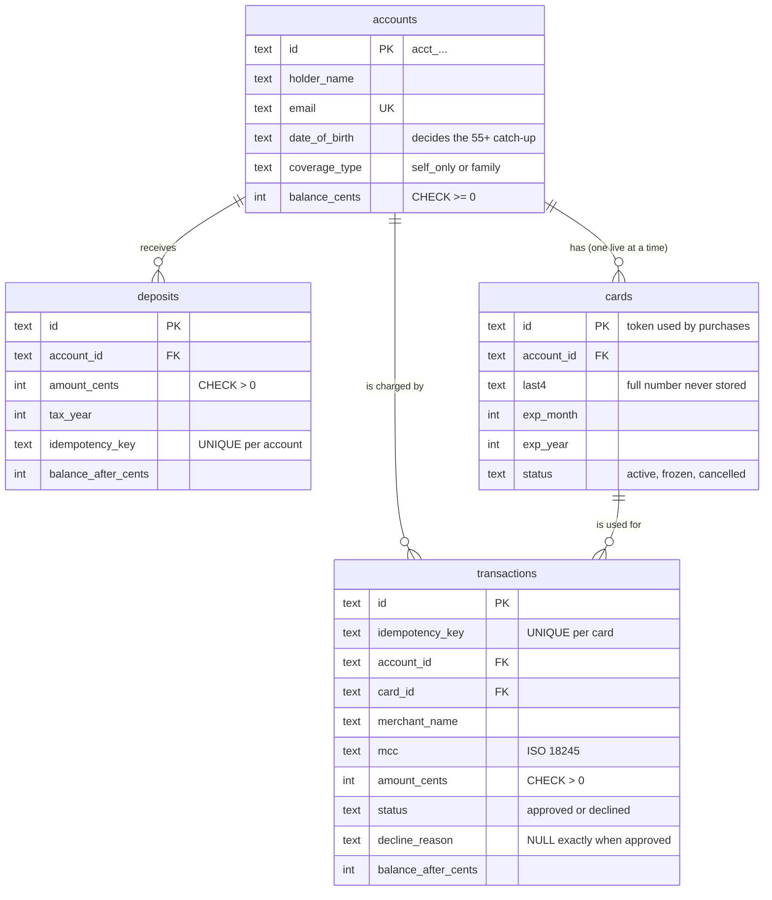

# Architecture

## 1. System architecture



The modules follow the assignment's four features, so each question has one place to
look:

| File | Job | Lines |
| --- | --- | --- |
| `api.py` | Turn HTTP into function calls, and every failure into JSON | ~120 |
| `accounts.py` | Create accounts, deposits within the IRS limit, the activity feed | ~160 |
| `cards.py` | Issue, replace and freeze cards; card numbers | ~85 |
| `purchases.py` | **Authorize a purchase.** The part that has to be right | ~190 |
| `db.py` | Connections, schema version, `write_transaction` (the lock) | ~70 |
| `schema.sql` | Tables plus the rules the database enforces itself | ~60 |

The business modules take a plain `sqlite3.Connection`, never a Flask request. That's why
the concurrency tests can call them from 90 threads at once, and why replacing Flask would
only touch `api.py`.

The server runs threaded (`app.run(threaded=True)`), so each request gets its own thread
and its own connection, and simultaneous purchases genuinely race.

## 2. Request flow: authorizing a purchase



### The checks, defined once

`purchases.CHECKS` is an ordered list of five checks. It is the only place the order is
written down:

1. Card has not been cancelled
2. Card is not frozen
3. Card is not expired (valid through the end of its expiry month)
4. Merchant is a qualified medical expense
5. Balance covers the amount

`authorize_purchase` walks the list and stops at the first failure. `decision_trace`
reads the same list to explain a stored transaction later: earlier checks passed, the
failing one failed, later ones never ran. Because the order defines both, the explanation
can't drift from the decision. An earlier version kept the order in two places, and a
test now builds one purchase that fails each check and asserts that reason and trace agree.

The order is deliberate. A $500 restaurant charge on a $5 balance is declined as "not a
medical expense", not "insufficient funds", because that's the reason that would still be
true after a deposit. Funds is checked last because it's the only check that changes
anything, and it has to happen atomically with the debit.

### Errors versus declines

**A declined purchase is not an error.** The request was valid and fully processed; the
answer was no. It returns `201` with `status: "declined"` and a `decline_reason`.

**Errors** are requests that can't be processed. Every one comes back as JSON in the same
shape, including crashes:

```json
{"error": {"code": "validation_error", "message": "Date of birth must be in the past.", "field": "date_of_birth"}}
```

| Status | Code | When |
| --- | --- | --- |
| 400 | `invalid_json` | Body isn't a JSON object |
| 404 | `not_found` | Unknown account or card |
| 409 | `email_taken`, `card_exists`, `contribution_limit_exceeded`, `idempotency_key_reused`, `invalid_card_state` | Conflicts with existing data |
| 422 | `validation_error` | Bad input. `field` names the input |
| 503 | `busy` | Waited 10 s for the lock (pathological load). Safe to retry |
| 500 | `internal_error` | A bug. Logged, and the transaction was rolled back |

Messages are written for a person, because the UI shows them as-is next to the field named
in `field`.

## 3. Data model



### Modelling decisions

**What an account holds.** Name and email identify the holder. Date of birth and health-plan
coverage are there because they set the IRS annual limit: $4,400 self-only or $8,750 family
in 2026, plus $1,000 for anyone 55 or older by the end of the year. I left out SSN, address
and employer. A real product needs them for identity checks and payroll, but they add nothing
to these flows, and sensitive fields shouldn't exist in a demo database.

**Money is integer cents.** `money.parse_amount` is the only place dollars are parsed:
`str -> Decimal -> int`. It rejects fractions of a cent rather than rounding, and it checks
bounds before doing any arithmetic, because rounding a value like `1e999999999` overflows
inside the decimal module. Formatting back to dollars is integer-only too.

**A stored balance, backed by a ledger.** Deposits plus approved purchases are a complete
ledger, so the balance could be computed with `SUM`. It's stored as well, to give concurrency
control one row to lock and conditionally update. Every test checks
`balance == deposits - approved purchases`, so the two can't silently drift.

**Every attempt is recorded**, declines included, with the reason and the balance the
decision saw. That's the audit trail support would need: "why was my pharmacy charge
declined at 2:14 pm?"

**Idempotency keys are scoped**: per card for purchases, per account for deposits. A key
means "this is a retry of something *I* sent", so it shouldn't collide with another
customer's key. An earlier version made keys globally unique, so account B got a 409 for a
key account A had used, which also revealed that the key existed. A retry must also repeat the
same purchase: same amount, MCC *and* merchant name. The first version ignored the merchant
and would return a different purchase's result.

**Invariants the database enforces itself**, whatever the application does:
- `CHECK (balance_cents >= 0)` on accounts
- `CHECK (amount_cents > 0)` on deposits and transactions
- `CHECK ((status = 'approved') = (decline_reason IS NULL))`
- `UNIQUE (email)`. The constraint, not a prior lookup, stops two simultaneous sign-ups
- A partial unique index allowing one live (active or frozen) card per account
- `UNIQUE (card_id, idempotency_key)` and `UNIQUE (account_id, idempotency_key)`

**No account "closed" state.** An earlier version had one, plus a decline reason for it, but
nothing could close an account, so that code never ran. Freezing the card covers "stop
spending" for this scope. Closing an account properly (pay out the balance, cancel the card)
is listed under improvements.

**Cards.** The 16-digit Luhn-valid number is generated at issuance and returned once; only
`last4` is stored. Purchases refer to the card by `card_id`, which plays the role of a
network token. In production the number would live in a PCI-scoped vault.

**Qualified expenses: an MCC allow-list.** Card networks tag every authorization with a
merchant category code. Medical categories are allowed; everything else, including unknown
codes, is declined. Failing closed suits a tax-advantaged account: a wrongly approved
purchase becomes taxable income plus a 20% penalty for the holder, while a wrongly declined
one is an inconvenience.

**Schema versioning.** `schema.sql` sets `PRAGMA user_version`. On startup `db.init_db`
creates the schema in a new file, or refuses to open a database from an older version with a
message saying to delete it. A real system would run migrations; for a local demo, a clear
refusal beats confusing failures halfway through a request.

**Why SQLite.** A real ACID database with real locking and zero setup. Its single-writer
model makes the concurrency guarantees easy to reason about and to test.

## 4. Concurrency handling

The required scenario: balance $100, purchases of $80 and $50 at the same moment. Only one
may be approved and the balance must never go negative.

The bug to prevent is the **check-then-act race**:

```
A: read balance = 100     B: read balance = 100
A: 100 >= 80, approve     B: 100 >= 50, approve
A: write 100 - 80 = 20    B: write 100 - 50 = 50    <- $130 spent from $100
```

The final balance is **$50, which is positive**, so a `CHECK (balance >= 0)` alone wouldn't
catch this lost update. `tests/test_concurrency.py` has a control test that runs exactly this
code under the same harness and confirms it approves both purchases.

### Three layers

1. **`BEGIN IMMEDIATE`** (`db.write_transaction`) takes SQLite's write lock *before* the
   first read. Reading the balance, deciding and writing all happen while no other writer
   can run; the next purchase waits and then sees the reduced balance. It has to be
   `IMMEDIATE`. The default `DEFERRED` starts as a reader and upgrades at the first write,
   and two transactions that have both read can't both upgrade. SQLite then fails one
   immediately with `database is locked` rather than waiting (57 such errors under the tests).
2. **The debit is one conditional statement**:
   `UPDATE … SET balance_cents = balance_cents - :amount WHERE id = :account AND balance_cents >= :amount RETURNING …`.
   Checking and taking the money can't be separated; no row back means not enough money.
3. **`CHECK (balance_cents >= 0)`** turns any overdraft bug that slips through into a
   rolled-back write instead of a negative balance.

### Which layer carries the weight? Measured, not assumed

`python scripts/mutation_check.py` removes layers in a copy of the code and reruns the
concurrency tests:

| Variant | Balance under race | Deposit limit under race | Same-key retries under race | Tests |
| --- | --- | --- | --- | --- |
| As built | correct | correct | correct | pass |
| Lock only (debit as read-check-write) | correct | correct | correct | pass |
| Conditional UPDATE only, no lock | correct | **20 of 20 $300 deposits accepted ($6,000 vs $4,400)** | **UNIQUE violation, HTTP 500** | fail |
| Deferred `BEGIN` | `database is locked` | errors | errors | fail |
| No lock and read-check-write | **overspends** | overspends | errors | fail |

**The transaction lock is the essential guarantee.** The conditional UPDATE protects the
balance on its own, but rules spanning several rows (the year-to-date deposit total; "has
this key been used?") need the whole read-decide-write sequence serialized. The other two
layers are cheap defense in depth.

### Watching it: server-side lock timings

Each purchase response includes `lock_timing`: when the request asked for the lock, got it,
finished its last statement, and released it. The values come from `time.perf_counter`, a
monotonic clock. The wall clock (`time.time`) can jump when the system syncs time, which
would corrupt durations. So the numbers compare across requests in one server process but
aren't times of day. They're diagnostics for that response and aren't stored.

The race timeline in the UI draws them. The tests use them as evidence too
(`test_one_purchase_holds_the_lock_at_a_time`):
1. most requests asked for the lock while another purchase held it, so the threads really
   overlapped;
2. no two purchases held the lock at once;
3. in lock order, each approved purchase saw exactly the balance the previous one left.

Two effects the timeline makes visible:
- **Gaps between bars.** SQLite's busy handler sleeps for growing intervals (1, 2, 5, 10 ms…)
  between retries, so a waiter can wake after the lock is already free. Correctness is
  unaffected; throughput under contention suffers. Postgres row locks hand over immediately.
- **Waves for large batches.** Browsers open at most six connections per host, so a
  30-purchase race from the UI arrives in waves. The tests release 40 to 90 threads at once.

### What the tests cover

- The brief's scenario, 50 rounds, two threads released by a `threading.Barrier`.
- 40 × $10 against $100: exactly 10 approved, balance exactly $0.
- The three-part lock-timing proof above.
- Qualified and non-qualified purchases racing; purchases racing deposits; 15 simultaneous
  retries with one key (one charge); 20 simultaneous deposits against the limit (exactly 14).
- A seeded random mix of 90 deposits, purchases and card freezes across three accounts, then
  the ledger invariant per account, no approved non-medical purchase, and every "insufficient
  funds" decline genuinely short of funds.
- 30 simultaneous HTTP requests against a real threaded server.
- The mutation check above, which shows the tests fail when the safety is removed.

## 5. Design tradeoffs

| Decision | Benefit | Cost, and what I'd change at scale |
| --- | --- | --- |
| SQLite with one database-wide write lock | No setup; easy to prove correct | All writes are serialized, even for unrelated accounts. On **Postgres** I'd keep the conditional `UPDATE`, lock per account with `SELECT … FOR UPDATE`, and use `INSERT … ON CONFLICT` for idempotency |
| Stored balance plus ledger rows | One row to lock; O(1) reads | Two sources that must agree. Tested here; production would add a reconciliation job |
| MCC allow-list | Simple, explainable, fails closed | Coarse: a pharmacy also sells candy, a grocery pharmacy counter is declined. Real programs add item-level checks (IIAS) and receipt review |
| Single-step authorization | Easy to reason about and demo | Real card flows authorize, then capture, with holds, reversals and refunds |
| Declines are HTTP 201 | "Processed" and "invalid" stay separate | Clients must read `status`, not just the HTTP code |
| Requests take dollars (`"12.34"`), responses give cents | Forms send what people type; responses can't be misread as floats | Asymmetric. A pure API would take cents both ways, as Stripe does |
| Tax year from the UTC date | One unambiguous rule | A deposit at 9 pm on Dec 31 in Michigan counts toward the next year; prior-year contributions until April aren't modelled |
| Old database refused, not migrated | No migration code for a demo | A real deployment needs migrations |
| `list_accounts` runs two queries per account | Simple code | Fine for a demo; a JOIN or batch query at scale |
| No authentication | Reviewers can try every flow immediately | Required before anything real |
| Plain JS UI, no build step | `python run.py` is the whole setup | Less structure than a framework for a bigger UI |

## 6. What I'd improve with more time

1. Authorize-then-capture with holds, reversals and refunds.
2. Postgres with per-account row locks (removing the busy-handler gaps), plus a load test.
3. Authentication; accounts scoped to the signed-in user.
4. Closing an account: pay out the balance, cancel the card.
5. Item-level eligibility (IIAS) and receipt substantiation.
6. Contribution limits as data; employer contributions; prior-year contributions.
7. Metrics: decline rate by reason, lock wait time.
