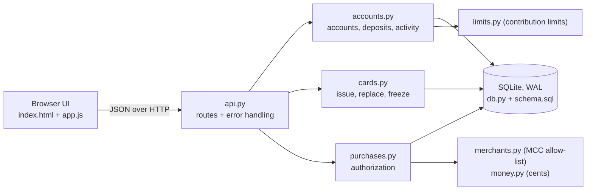
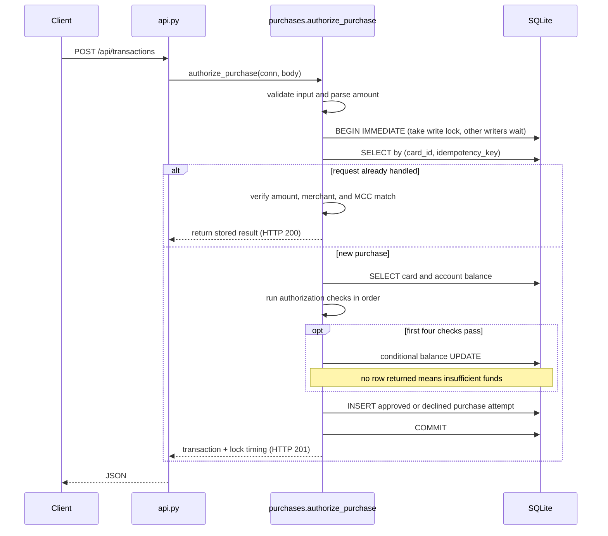
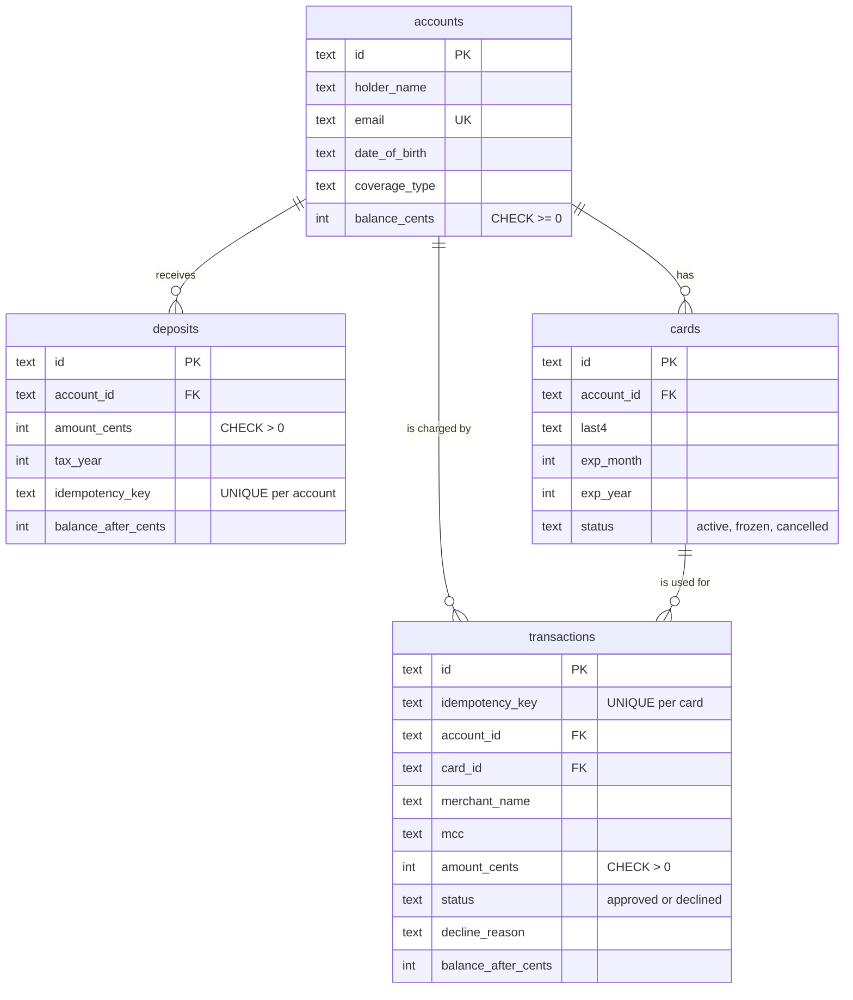

# Architecture

## 1. System architecture



The application is split by responsibility so the HTTP layer, business rules, and database behavior are not all mixed together.

| File | Responsibility |
| --- | --- |
| `api.py` | HTTP routes, request parsing, and error responses |
| `accounts.py` | Accounts, contributions, limits, and activity |
| `cards.py` | Card issuance, replacement, freezing, and unfreezing |
| `purchases.py` | Purchase authorization and decision checks |
| `db.py` | Connections, schema initialization, and write transactions |
| `schema.sql` | Persisted data model and database constraints |
| `merchants.py` | Merchant-category eligibility |
| `money.py` | Dollar-string parsing and integer-cent formatting |
| `limits.py` | Contribution limits used by the simulator |

The business modules take a plain `sqlite3.Connection` instead of depending directly on a Flask request. That keeps the business logic separate from the HTTP layer and also lets the concurrency tests call the same functions directly from many threads.

The Flask server runs in threaded mode, with each request using its own database connection. That lets concurrent requests reach the same persisted state through separate connections instead of sharing one in-memory object.

---

## 2. Request flow: authorizing a purchase



### Authorization checks

`purchases.CHECKS` defines the purchase checks in one order:

1. The card has not been cancelled.
2. The card is not frozen.
3. The card is not expired.
4. The merchant category is eligible.
5. The account has enough balance.

`authorize_purchase` stops at the first failed check. The same ordering is used when building the decision trace shown later in the UI, so the explanation and the authorization decision come from the same source.

The order is intentional. For example, a `$500` restaurant purchase on an account with only `$5` is declined for merchant eligibility before funds. Adding money later would not make the restaurant purchase eligible, so that is the more useful reason to return.

Funds is checked last because it is the check tied directly to the balance update and has to stay consistent with the debit.

### Errors versus declines

A declined purchase is not treated as an application error. The request was valid and the authorization was processed successfully; the result was simply a decline.

A decline therefore returns `201` with:

```json
{
  "status": "declined",
  "decline_reason": "..."
}
```

Requests that cannot be processed use a consistent JSON error shape:

```json
{
  "error": {
    "code": "validation_error",
    "message": "Date of birth must be in the past.",
    "field": "date_of_birth"
  }
}
```

| Status | Meaning |
| --- | --- |
| `400` | Request body is not valid JSON |
| `404` | Account or card does not exist |
| `409` | Request conflicts with existing state |
| `422` | Input validation failed |
| `503` | Database remained busy long enough for the request to fail |
| `500` | Unexpected application error |

When an error is associated with one input, the response includes `field` so the UI can place the message next to the relevant control.

---

## 3. Data model



### Accounts

An account stores the information needed for the flows in this take-home: the owner's name, email, date of birth, coverage type, and current balance.

I left out fields such as SSN, address, and employer because they are not needed for these flows, and I did not want unnecessary sensitive data in the demo database.

The HSA rules used by the simulator are intentionally simplified for the scope of the assignment.

### Money

Money is stored as integer cents rather than floating-point dollars.

`money.parse_amount` is the single path for converting an input dollar string into cents:

```text
"12.34" -> Decimal -> 1234
```

It rejects fractions of a cent instead of silently rounding them.

Formatting back to dollars also uses integer-cent values rather than floating-point arithmetic.

### Stored balance and ledger rows

The account stores its current balance, while contributions and approved purchases form the history behind that balance.

Keeping the current balance gives the concurrency code one row that can be checked and updated atomically.

The test suite also checks the corresponding ledger invariant:

```text
balance = contributions - approved purchases
```

This makes it possible to detect a mismatch between the stored balance and the transaction history.

### Contributions

Contributions are stored as individual rows rather than only keeping one accumulated contribution total.

That preserves the history behind the annual total and gives the contribution-limit check persisted state to evaluate.

### Cards

Cards are modeled separately because they have their own lifecycle.

A card can be active, frozen, cancelled, or replaced without replacing the HSA account itself.

The full generated card number is returned at issuance, while only the last four digits are stored. Purchases refer to the card through `card_id`.

### Purchase attempts

Both approved and declined purchase attempts are persisted.

A decline does not move money, but the authorization still happened. Keeping that record lets the activity history explain what was attempted and why it was declined.

### Idempotency

Idempotency keys are scoped per card for purchases and per account for contributions.

The key represents a retry of the same logical operation, so a retry should not become a second charge or contribution.

For purchase retries, the amount, merchant name, and MCC must also match the original request before the stored result is returned.

### Database constraints

The database enforces several invariants independently of the Python code:

```text
CHECK (balance_cents >= 0)
CHECK (amount_cents > 0)
CHECK ((status = 'approved') = (decline_reason IS NULL))
UNIQUE (email)
UNIQUE (card_id, idempotency_key)
UNIQUE (account_id, idempotency_key)
```

There is also a partial unique index that allows only one live card, either active or frozen, per account.

Using database constraints here gives the application another layer of protection if the application code makes a mistake.

### Merchant eligibility

Qualified expenses are represented with an MCC allow-list.

Medical merchant categories are allowed, while ineligible or unknown categories are declined.

For this simulator, I preferred the safer default rather than guessing that an unknown purchase was eligible.

### Schema versioning

`schema.sql` stores a `PRAGMA user_version`.

On startup, `db.init_db` creates the schema for a new database or refuses to open an incompatible older schema.

For a real deployed service I would use migrations, but for a local take-home I preferred an explicit failure over allowing the application to run against a schema it does not understand.

### Why SQLite

SQLite keeps the setup small while still giving the project real transactions and locking behavior to test.

Its single-writer model also makes the concurrency behavior relatively easy to inspect for this assignment.

The main downside is that the lock is database-wide, so unrelated accounts can block one another during writes. I would revisit that design for a larger service.

---

## 4. Concurrency handling

The required race is an account with `$100` receiving an `$80` purchase and a `$50` purchase at approximately the same time.

Only one can safely succeed.

The failure to avoid is a check-then-act race:

```text
A: read balance = 100        B: read balance = 100
A: 100 >= 80, approve        B: 100 >= 50, approve
A: write 20                  B: write 50
```

Both requests have approved based on the same original balance, so `$130` was approved against an account that only had `$100`.

The final stored balance could still be positive, which means a simple `CHECK (balance_cents >= 0)` is not enough to detect this kind of lost update.

### Layer 1: `BEGIN IMMEDIATE`

Write workflows that depend on existing state run inside `db.write_transaction`, which starts with:

```sql
BEGIN IMMEDIATE
```

This takes SQLite's write lock before the read-decide-write sequence begins.

For a purchase, that means one request reads the balance, makes its decision, writes the result, and commits before another writer can make a decision using the same old state.

The contribution path needs the same protection because it reads the year-to-date total before deciding whether another contribution is allowed.

A deferred transaction does not give the same behavior. Two transactions can both begin by reading and then conflict when they later try to upgrade to writers.

### Layer 2: conditional debit

Purchases also debit the account with one conditional statement:

```sql
UPDATE accounts
SET balance_cents = balance_cents - :amount
WHERE id = :account
  AND balance_cents >= :amount
RETURNING balance_cents
```

If no row is returned, there was not enough balance when the update executed.

This protects the individual debit, but it does not replace the transaction around workflows that make a larger decision from previously read state.

### Layer 3: database constraint

The account table also has:

```sql
CHECK (balance_cents >= 0)
```

This provides another defensive layer by rejecting any write that would create a negative balance.

### What the mutation check showed

The project includes:

```bash
python scripts/mutation_check.py
```

The script copies the project, weakens specific concurrency protections, and reruns the relevant tests.

| Variant | Balance race | Contribution limit race | Same-key retries | Result |
| --- | --- | --- | --- | --- |
| Current implementation | correct | correct | correct | pass |
| Lock only, debit changed to read-check-write | correct | correct | correct | pass |
| Conditional update only, transaction lock removed | correct | fails | fails | fail |
| Deferred `BEGIN` | lock errors | errors | errors | fail |
| No lock + read-check-write | overspends | overspends | errors | fail |

The mutation results showed that the transaction lock is necessary for invariants that span multiple reads and writes.

The conditional update protects the balance on its own, but rules such as the year-to-date contribution limit and idempotent retries depend on a larger read-decide-write sequence.

The conditional update and database constraint therefore act as additional protection rather than replacing the transaction.

### Lock timing

Each purchase response includes diagnostic lock timing for when the request:

```text
asked for the lock
acquired the lock
finished its database work
released the lock
```

The durations use `time.perf_counter`, which is monotonic and appropriate for measuring elapsed time.

The values are only diagnostic for the running server and are not persisted.

The UI uses them to distinguish waiting for the lock, holding the lock, and the final authorization result.

The tests also use these timings to check that requests overlap while no two purchase workflows hold the SQLite write lock at the same time.

### Browser versus test concurrency

Large races started through the browser can arrive in waves because browsers limit the number of simultaneous connections to one host.

The concurrency tests do not depend on the browser. They release groups of Python threads directly so the backend can be tested under heavier simultaneous contention.

### What the concurrency tests cover

The concurrency suite includes the assignment's `$100 / $80 / $50` race, repeated across multiple rounds.

It also tests larger batches such as forty `$10` purchases against `$100`, where exactly ten should succeed and the final balance should be `$0`.

Other tests cover purchases racing with contributions, eligible and ineligible purchases running together, simultaneous retries using one idempotency key, concurrent contributions near the annual limit, mixed workloads across multiple accounts, and concurrent requests through the threaded HTTP server.

The mutation check is used alongside those tests to make sure several intentionally unsafe versions stop passing.

I do not treat this as proof that every possible concurrency bug is covered. It gives evidence that the tests detect the specific failure modes represented by those cases and mutations.

---

## 5. Design tradeoffs

| Decision | Benefit | Cost / what I would revisit |
| --- | --- | --- |
| SQLite with one database-wide write lock | Very small setup and straightforward transaction behavior | Unrelated writes are serialized. At larger scale I would evaluate Postgres and per-account row locking |
| Stored balance plus ledger rows | Fast balance reads and one row to update atomically | Two representations must stay consistent. A production system would also need reconciliation |
| MCC allow-list | Simple and explainable eligibility rule | Merchant categories are coarse. A real product would need more detailed eligibility handling |
| Single-step authorization | Small enough to reason about for the take-home | Real card flows also need capture, holds, reversals, and refunds |
| Declines return HTTP `201` | Separates a processed authorization decline from an invalid request | Clients must read the transaction `status`, not only the HTTP status |
| Requests use dollar strings, storage uses cents | Matches what users type while keeping stored money exact | The API representation is asymmetric. A pure service API could use cents in both directions |
| Tax year comes from the current UTC date | Gives the simulator one consistent rule | Real contribution timing rules are more complicated |
| Old schema versions are refused | Avoids migration machinery in a local demo | A deployed service needs schema migrations |
| `list_accounts` performs more than one query per account | Keeps the implementation simple | I would batch or join these reads at larger scale |
| No authentication | Makes every flow immediately testable by a reviewer | Authentication and authorization are required before real use |
| Plain JavaScript UI with no build step | `python run.py` is enough to start the whole app | A larger frontend would benefit from more structure |

---

## 6. What I would improve with more time

The first production-level change I would make to the payment model is separating authorization from capture and supporting holds, reversals, and refunds.

For database scalability, I would investigate Postgres with per-account row locking and run load tests under higher contention.

I would also add authentication and scope every account to the signed-in user.

Other missing product flows include closing an account, paying out the remaining balance, and cancelling its card.

The medical-expense model would need deeper eligibility rules than the MCC allow-list used here, potentially including item-level eligibility and receipt review.

I would also move contribution limits into configurable data and support cases that the take-home intentionally leaves out, such as employer and prior-year contributions.

Finally, I would add production metrics around decline reasons, retry behavior, database lock wait time, and other failures that are difficult to diagnose from a local test environment.
